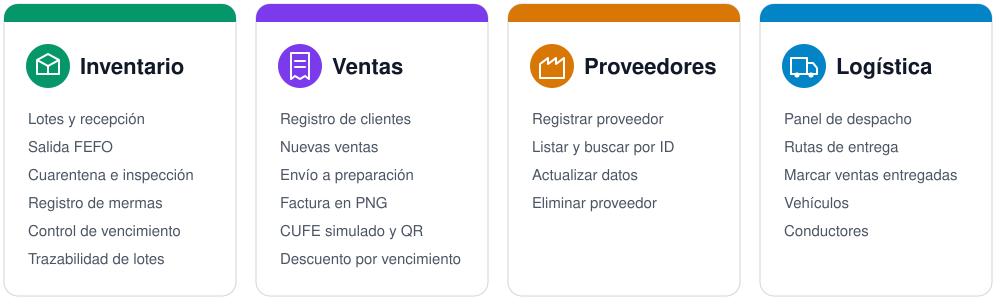
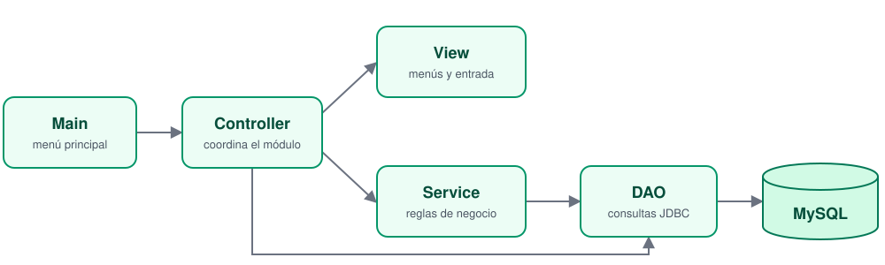
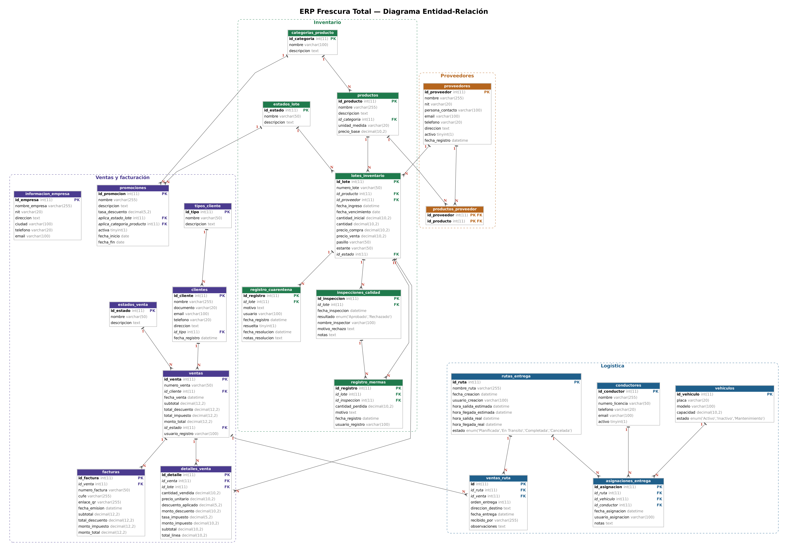
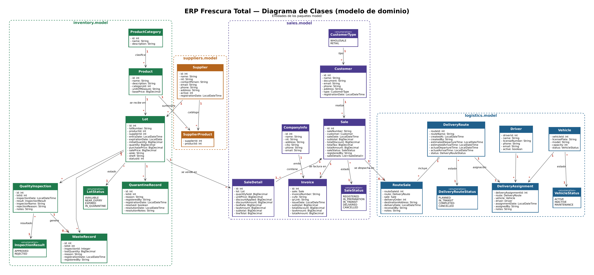

<div align="center">


<br/>


**Sistema de gestión para la bodega de alimentos Frescura Total.**
Controla lotes, ventas, proveedores y entregas desde la consola.

[Módulos](#módulos) ·
[Flujo](#flujo-del-negocio) ·
[Arquitectura](#arquitectura) ·
[Instalación](#instalación) ·
[Base de datos](#base-de-datos) ·
[Equipo](#equipo)

</div>

---

## Sobre el proyecto

En una bodega de alimentos, un lote que vence sin venderse es dinero perdido. Este ERP lleva cada producto desde que llega del proveedor hasta que se entrega al cliente: prioriza los lotes que vencen primero (FEFO), aísla los que tienen problemas de calidad y permite rastrear a qué clientes llegó cada lote.

## Módulos



<details>
<summary><b>Ver las opciones de cada menú</b></summary>

<br/>

| Módulo | Opciones en la aplicación |
|---|---|
| **Inventory** | List all lots · List available lots by product (FEFO) · Register goods reception · Put lot in quarantine · Inspect quarantined lot · Register waste · Run expiration check · Trace lot · List lots by status |
| **Sales** | Register customer · List customers · New sale · List sales · Send sale to preparation (logistics) · Find customer by ID · Import customers from file · Generate commercial statistics · Register sale return |
| **Suppliers** | Register supplier · List suppliers · Find supplier by ID · Update supplier · Delete supplier · Search supplier by name · Generate daily purchase report (CSV) |
| **Logistics** | Dispatch panel · Create delivery route · List delivery routes · Mark sale as delivered · Register vehicle · Register driver · List vehicles · List drivers |

</details>

## Flujo del negocio


| Entidad | Estados |
|---|---|
| **Lote** | `AVAILABLE` · `NEAR_EXPIRY` · `EXPIRED` · `IN_QUARANTINE` |
| **Venta** | `REGISTERED` → `IN_PREPARATION` → `IN_TRANSIT` → `DELIVERED` → `RETURNED` (opcional) · `CANCELLED` |
| **Ruta** | `PLANNED` · `IN_TRANSIT` · `COMPLETED` · `CANCELLED` |

> [!NOTE]
> Las rutas se crean directamente en `IN_TRANSIT` y pasan a `COMPLETED` al terminar. `PLANNED` y `CANCELLED` existen en el modelo, pero todavía ninguna opción del menú los asigna.

## Arquitectura

Cada módulo sigue el patrón MVC con DAO para el acceso a datos. Inventario y Ventas añaden una capa de servicio con las reglas de negocio; en los demás casos, el controller llama directamente al DAO. `DatabaseConnection` es un singleton que comparte la conexión JDBC.



```text
src/main/java/com/frescuratotal/erp/
├── Main.java        Punto de entrada y menú principal
├── common/          Conexión, utilidades y excepciones
├── inventory/       controller · model · view
├── sales/           controller · model · view
├── suppliers/       controller · model · view
└── logistics/       controller · model · view · Dao
```

## Tecnologías

| Tecnología | Uso |
|---|---|
| **Java 21** | Lenguaje de la aplicación |
| **Maven** | Compilación y dependencias |
| **MySQL** + `mysql-connector-j` | Persistencia mediante JDBC |
| **ZXing** | Código QR de las facturas |

## Instalación

### Requisitos

- JDK 21
- MySQL
- Maven o IntelliJ IDEA

### Pasos

**1. Clona el repositorio**

```bash
git clone https://github.com/Eidan210/Frescura-Total-Proyecto-Java.git
cd Frescura-Total-Proyecto-Java
```

**2. Crea la base de datos con sus datos de prueba**

```bash
mysql -u root -p < docs/database.sql
```

> [!WARNING]
> El script ejecuta `DROP DATABASE IF EXISTS erp_frescura_total`. Si ya tienes esa base de datos, se borra por completo.

**3. Configura la conexión**

Copia `src/main/resources/db.properties.example` como `src/main/resources/db.properties` y pon tu contraseña:

```properties
db.url=jdbc:mysql://localhost:3306/erp_frescura_total
db.user=root
db.password=your_password_here
```

> [!NOTE]
> `db.properties` está en `.gitignore`, así que tus credenciales no se suben al repositorio.

**4. Ejecuta la aplicación**

Abre el proyecto en IntelliJ y ejecuta `Main`, o usa Maven:

```bash
mvn compile exec:java -Dexec.mainClass=com.frescuratotal.erp.Main
```

Las facturas se guardan como PNG en la carpeta `invoices/`.

## Base de datos

El script [`docs/database.sql`](docs/database.sql) crea 22 tablas y carga datos de prueba.

| Área | Tablas |
|---|---|
| **Catálogos** | `estados_lote` · `tipos_cliente` · `estados_venta` · `categorias_producto` |
| **Empresa** | `informacion_empresa` |
| **Proveedores y productos** | `proveedores` · `productos` · `productos_proveedor` |
| **Inventario y calidad** | `lotes_inventario` · `registro_cuarentena` · `inspecciones_calidad` · `registro_mermas` |
| **Promociones** | `promociones` |
| **Clientes y ventas** | `clientes` · `ventas` · `detalles_venta` · `facturas` |
| **Logística** | `conductores` · `vehiculos` · `rutas_entrega` · `asignaciones_entrega` · `ventas_ruta` |

> [!IMPORTANT]
> Si tu base se creó con una versión anterior del script, ejecuta [`docs/migrations/001_ejercicios_preparatorios.sql`](docs/migrations/001_ejercicios_preparatorios.sql): agrega `modalidad_entrega` y `recargo_entrega` a `ventas` y el estado `Devuelta` (id 6).

<details>
<summary><b>Diagrama entidad-relación</b></summary>
<br/>

</details>

<details>
<summary><b>Diagrama de clases</b></summary>
<br/>

</details>

## Ejercicios preparatorios

Solución de la guía de práctica (5 ejercicios), integrada en las capas existentes. Archivos editados y explicación por ejercicio: [`docs/EJERCICIOS_PREPARATORIOS.md`](docs/EJERCICIOS_PREPARATORIOS.md).

| # | Ejercicio | Dónde está | Menú |
|---|---|---|---|
| 1 | Caché de clientes (Singleton) | `sales/model/CustomerCache`, `CustomerService` | Sales → 6 |
| 2 | Reporte diario de compras CSV | `suppliers/model/PurchaseReport*` | Suppliers → 7 |
| 3 | Tarifas de entrega (Strategy) | `sales/model/delivery/` | Sales → 3 (al confirmar) |
| 4 | Importar clientes desde texto | `sales/model/CustomerImportService` | Sales → 7 |
| 5 | Estadísticas con Stream API | `sales/model/stats/` | Sales → 8 |

<details>
<summary><b>Decisiones técnicas</b></summary>
<br/>

- **Caché:** `CustomerCache` crea su única instancia al cargar la clase y guarda copias de `Customer`, así nadie modifica lo que hay en memoria. `CustomerService` implementa `CustomerDao`: los controladores de ventas y logística siguen llamando `findById` igual que antes, y la decisión memoria/SQL queda dentro del servicio. `SaleService` recibe el mismo `CustomerService`, por lo que ambos comparten la caché. Nunca se guardan clientes inexistentes ni incompletos; al actualizar o borrar se invalida la copia.
- **Compras:** el modelo no tiene una tabla `compras`; cada recepción de mercancía es un lote (`lotes_inventario`) con proveedor, cantidad y precio de compra. Por eso `NumeroCompra = id_lote` y `MontoTotal = cantidad_inicial × precio_compra`. La fecha sale de `LocalDate.now()` y se filtra por rango (`>= hoy AND < mañana`) para usar el índice. El archivo `compras_AAAA-MM-DD.csv` se crea en la carpeta desde la que se ejecuta el proyecto.
- **Entregas:** `DeliveryFeeService` elige la estrategia con un `EnumMap` (sin `if`/`switch`); los porcentajes viven solo en `StandardDeliveryStrategy` (0 %) y `UrgentDeliveryStrategy` (12 %). El recargo se aplica sobre el total de la venta (con IVA), se muestra antes de confirmar y se guarda en `ventas.modalidad_entrega` / `recargo_entrega`.
- **Importación:** primero se valida todo el archivo (cabecera, 5 campos no vacíos, correo, `MAYORISTA`/`MINORISTA`, documentos repetidos en el archivo o en la base, longitudes de columna) y solo después se inserta dentro de una transacción: cualquier fallo hace rollback y no queda nada a medias. `clientes_importar.txt` de ejemplo está en la raíz. Los clientes importados no traen dirección.
- **Estadísticas:** un JOIN `ventas → detalles_venta → lotes_inventario → productos → categorias_producto` + `clientes` se convierte en `SaleStatisticsRow`. Como el ERP no tiene un estado "CONFIRMADA", cuenta como confirmada toda venta que no esté `CANCELLED` ni `RETURNED`. Para las devoluciones se agregó el estado `RETURNED` (Sales → 9, solo para ventas entregadas).

</details>

Las pruebas de cada caso obligatorio están en `src/test/java` (`CustomerCacheTest`, `PurchaseReportServiceTest`, `DeliveryFeeServiceTest`, `CustomerImportServiceTest`, `CommercialStatisticsServiceTest`).

## Flujo de trabajo

| Rama | Propósito |
|---|---|
| `main` | Versión estable |
| `develop` | Integración del equipo |
| `feature/*`, `fix/*`, `docs/*` | Cambios puntuales, que entran a `develop` por pull request |

## Equipo

- **Eidan210**
- **reatiguiadriana901**
- **sergioRepository**

<div align="center">
<br/>
<sub>Hecho por el equipo de Frescura Total</sub>
</div>
